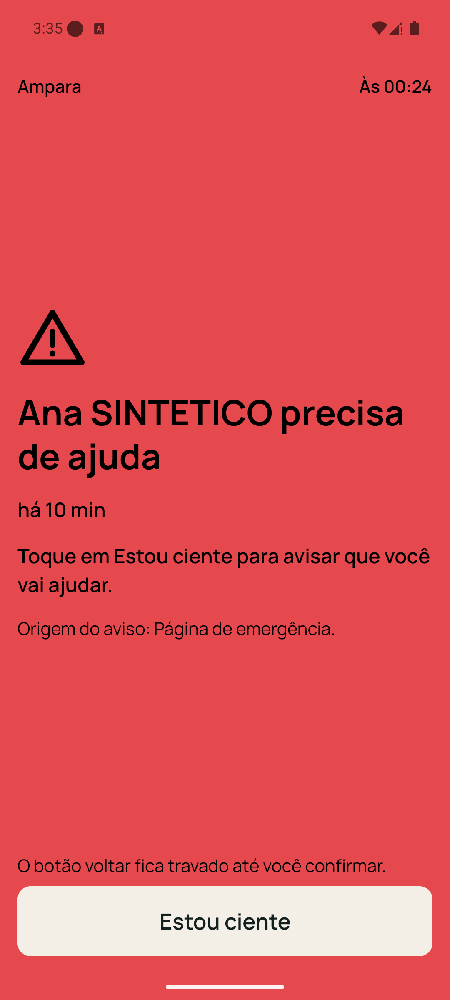
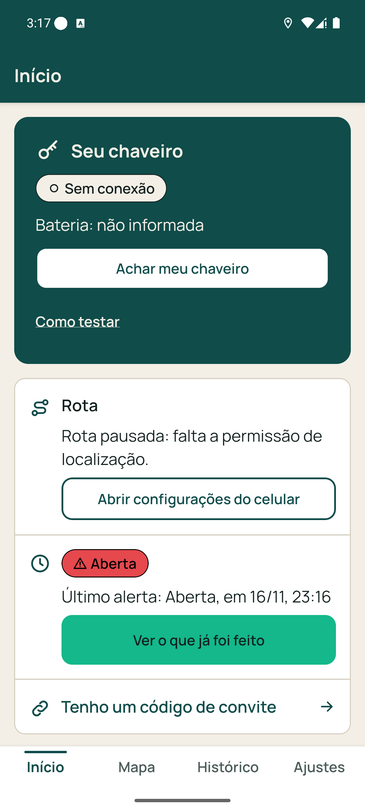
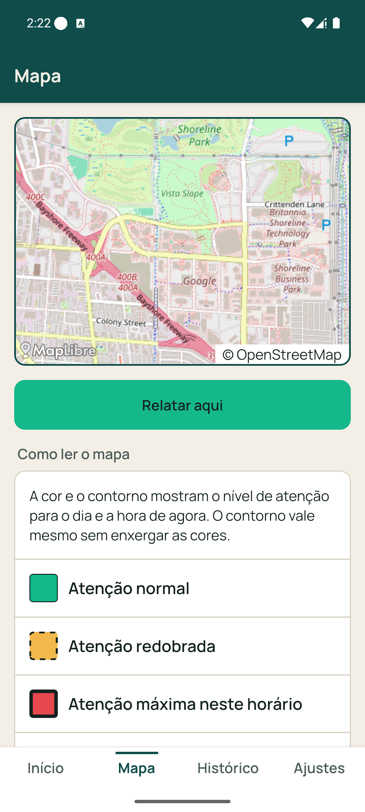

# Ampara: app do cidadão e do guardião

*Levaram seu celular. Não levam o resto.*

App Android (Expo SDK 58, React Native, TypeScript, Expo Router) da Global Solution 2026.2 da FIAP, equipe CitizenTech. Disciplina: Mobile Development & IOT.

## Ficha da CitizenTech

| Campo | Valor |
|---|---|
| Nome | **Ampara**: "Levaram seu celular. Não levam o resto." |
| Cidade e bairro | São Paulo, capital: eixo da CPTM Linha 9-Esmeralda (Pinheiros como estação crítica) e corredores de quebra-vidro |
| Cidadão beneficiado | Quem anda com o celular em SP e o **guardião** (parente ou amigo que age por ele na hora) |
| Problema, em uma frase | Depois de um roubo de celular, a vítima fica de 30 a 90 minutos sem aparelho e em choque, e é nessa janela que os criminosos entram no banco e nas contas. |
| Como funciona | Antes: o app guarda o que a vítima não lembraria na hora (IMEI, bancos, operadora, guardiões) e a rota dos últimos 7 dias. Durante: um clique no chaveiro (ESP32) ou um código digitado em outro aparelho dispara um alarme em tela cheia no celular do guardião, que segue um passo a passo de bloqueio. Depois: a vítima marca na rota onde e quando foi roubada e o Ampara gera o BO com o IMEI; a ocorrência, minimizada e com consentimento, vai para um painel da polícia (simulado). O Ampara não bloqueia o celular: avisa quem pode bloquear contas e linha. |
| O que cada parte faz | Veja o [README da raiz](../README.md). Este app consome a API Ampara (C#/.NET) e tem a página de emergência ao lado, em [web-emergencia](../web-emergencia/README.md). |
| Link do repositório | https://github.com/P0lid0/ampara |
| Indicador de impacto | minutos entre o roubo e o primeiro bloqueio confirmado pelo guardião; % de BOs gerados com IMEI válido; tempo para gerar o BO |
| ODS conectados | 11, 10, 9 e 16 ([docs/ods.md](../docs/ods.md)) |

Vídeo do app rodando (até 3 min, YouTube não listado): *a gravar; o roteiro está em [docs/roteiro-video.md](docs/roteiro-video.md)*.

## O que o app tem

| Área | Onde está no código |
|---|---|
| Rotas e telas (entrar, onboarding de 8 passos, abas Início, Mapa, Histórico e Ajustes, alarme e passo a passo do guardião, rota, BO, relato) | `src/app/` |
| Consumo da API Ampara (rotas `/api/v1`) e tempo real por SignalR | `src/api/`, `src/guardiao/hub.ts` |
| Banco local (SQLite, `expo-sqlite`): sessão, cadastro, fila da rota offline | `src/db/` |
| Alarme em tela cheia, sirene, notificação (notifee) e confirmação do guardião | `src/guardiao/`, `src/app/guardiao/` |
| Rota dos últimos 7 dias em segundo plano e linha do tempo | `src/rota/`, `src/app/rota.tsx` |
| Mapa de risco (MapLibre), relatos e camadas | `src/mapa/`, `src/app/(tabs)/mapa.tsx` |
| IMEI com dígito verificador (Luhn), câmera e digitação | `src/imei/` |
| Modo demonstração (sem internet nem chaveiro) | interruptor em Ajustes (`src/app/(tabs)/ajustes.tsx`) e `src/guardiao/eventos.ts` |
| Sistema de design (tokens, componentes, ícones) | `src/theme/`, `src/ui/`, [MOBILE-DESIGN.md](MOBILE-DESIGN.md) |

## Como rodar

Pré-requisitos: Node 22, Android Studio com um emulador (Android 14 ou superior) e a API Ampara no ar (`dotnet run --project api/Ampara.Api`, porta 5080).

```bash
cd app
npm install
cp .env.example .env     # EXPO_PUBLIC_API_URL; vazio usa http://10.0.2.2:5080 (a API vista do emulador)
npx expo run:android     # compila e abre no emulador
```

Verificação:

```bash
npx tsc --noEmit         # tipos
npx jest                 # 55 suítes, 688 testes
```

Para a demonstração completa (alarme, página de emergência e BO) suba também a Ponte Polícia (`ponte-policia/`, porta 8000) e a página de emergência (`web-emergencia/`, porta 5173). No `.env` da raiz use `PONTE_URL=http://127.0.0.1:8000` (não `localhost`: no Windows ele tenta o IPv6 primeiro e estoura o tempo) e `RISCO_CSV` com o caminho absoluto de `ml/saida/risco.csv`.

Para o alarme tocar, o guardião precisa ligar **Ajustes > Sou guardião: receber alarmes** e liberar notificações em tela cheia (Android 14: Configurações > Apps > Ampara > Notificações em tela cheia). Esse interruptor volta desligado quando o app é aberto de novo com uma conta.

## APK

O APK de release (cerca de 99 MB) não entra no Git (limite prático de 50 MB). Gerado em `app/apk/ampara.apk`, que fica fora do repositório; se for preciso entregar, a opção é um release do GitHub, só com a decisão da equipe. Para gerar de novo no Windows:

```bash
npx expo prebuild --platform android --clean
node scripts/preparar-android.js          # aponta o CMake 3.31.6 e mantém os caminhos curtos
cd android
./gradlew.bat assembleRelease -PreactNativeArchitectures=x86_64,arm64-v8a
```

Exige `LongPathsEnabled=1` no Windows, o CMake 3.31.6 do SDK e `JAVA_TOOL_OPTIONS="-Djava.io.tmpdir=C:/ampara-tmp -Djdk.net.unixdomain.tmpdir=C:/ampara-tmp"` com a pasta criada. O primeiro build leva cerca de 53 minutos; os seguintes, cerca de 15. A regra do R8 para o WorkManager (usado pelo notifee) já está no `app.config.ts`.

## Prints

Tirados do APK de release rodando no emulador, com conta sintética (nome com "SINTETICO", IMEI de teste). Todos em [docs/prints/](docs/prints/).

| Tela | Arquivo |
|---|---|
| Entrar | `01-entrar.png` |
| Criar conta | `02-conta.png` |
| IMEI com erro e IMEI conferido | `03-imei-erro.png`, `04-imei.png` |
| Bancos e operadora | `05-contas.png` |
| Convite de guardião (código e QR) | `06-convite-qr.png` |
| Chaveiro | `07-chaveiro.png` |
| Consentimento da rota | `08-consentimento-rota.png` |
| Código de emergência | `09-codigo-emergencia.png` |
| Início | `10-inicio.png` |
| Alarme do guardião | `11-alarme.png` |
| Passo a passo | `12-passo-a-passo.png` |
| Rota (marcar onde foi) | `13-rota.png` |
| Histórico | `14-historico.png` |
| BO | `15-bo.png` |
| Mapa de risco | `16-mapa.png` |
| Relato | `17-relato.png` |
| Checklist de prevenção | `18-checklist.png` |
| Ajustes | `19-ajustes.png` |





Antes e depois da etapa de design: [docs/design/antes-depois/](docs/design/antes-depois/). Auditoria e críticas: [docs/design/](docs/design/).

## Acessibilidade

- Contraste de texto de pelo menos 4,5:1, testado em `src/theme/__tests__/contraste.test.ts` para todos os pares de cor usados. O vermelho do alarme é sempre vermelho e o texto sobre ele é preto (5,4:1).
- Alvos de toque de pelo menos 48 dp (56 dp nas ações, 64 dp no alarme); `src/__tests__/acessibilidade.test.tsx` varre o código e reprova alvo menor.
- Estado nunca só por cor: chips com ícone e palavra, aba ativa com barra, células do mapa com contorno.
- Fonte do sistema ampliada: o texto cresce até o teto de cada variante e nada fica cortado.
- Leitor de tela: rótulos falados em todos os botões e campos, erros anunciados, o alarme lido a cada 10 s.
- Linguagem simples, uma ação principal por tela, barra de ação fixa na base com a área segura.

## Limites e honestidade

- Todos os dados são simulados; nenhum dado pessoal real. A polícia é um painel simulado (Ponte Polícia).
- O mapa só tem dados para a capital de São Paulo; fora dela o app mostra a região de Pinheiros e avisa.
- O app não bloqueia o celular nem as contas: avisa quem pode.
- O alarme em tela cheia depende do Android liberar a notificação em tela cheia; sem isso o guardião usa "Alarme sem tela cheia" em Ajustes.
- O APK foi testado só em emulador Android; não foi testado em aparelho físico.
- A rota em segundo plano foi provada num spike (`qa/spikes/gps-background/`) e no emulador, não numa semana de uso real.

## Integrantes

Pedro Martins e Vitor Cesarino Marchese (veja [integrantes.txt](../integrantes.txt)). Prompts de IA usados em [prompts.md](../prompts.md).
