<section class="capa">

<p class="capa-selo">Global Solution 2026.2 · CitizenTech · FIAP</p>

# Ampara

<p class="capa-lema">“Levaram seu celular. Não levam o resto.”</p>

<p class="capa-titulo">Cyber Security: documentação da camada de proteção de dados pessoais</p>

<p class="capa-sub">Motor de PII, taint analysis com sinks reais, tradução de falhas por IA e o Painel Risco Cidadão</p>

| | |
|---|---|
| **Integrantes** | Pedro Martins (RM_____) · Vitor Cesarino Marchese (RM_____) |
| **Disciplina** | Cyber Security |
| **Data** | 15 de novembro de 2026 |
| **Repositório** | https://github.com/P0lid0/ampara |

<p class="aviso-sintetico"><strong>Dados sintéticos.</strong> Todo CPF, e-mail, senha, IMEI, laudo e usuário que aparece neste documento foi inventado para a demonstração. Nenhum dado de pessoa real foi usado em código, banco, prints ou testes.</p>

</section>

<div class="quebra"></div>

## Sumário

1. Visão geral e arquitetura
2. Parsing PII
3. Taint Analysis
4. IA na remediação
5. Painel Risco Cidadão
6. Como executar e testar
7. Limitações honestas

<div class="quebra"></div>

## 1. Visão geral e arquitetura

O Ampara guarda dados que a vítima de um roubo de celular não lembraria na hora: IMEI, bancos, operadora, guardiões, rota. Por isso a própria API não pode vazar esses dados. A camada de Cyber faz três coisas, nesta ordem: **reconhece** o dado pessoal quando ele entra, **acompanha** esse dado até cada ponto de saída (sink) e **traduz** qualquer bloqueio para uma frase que um cidadão leigo entenda.

O valor do dado nunca é gravado em lugar nenhum de apoio: o rastro guarda só *de onde veio, qual campo, qual classe, por qual saída e o que foi decidido*.

<svg viewBox="0 0 760 250" xmlns="http://www.w3.org/2000/svg" role="img" aria-label="Fluxo: fonte, scanner, marcação no escopo, sinks, rastro, IA e painel" font-family="Segoe UI, Arial, sans-serif" font-size="13">
  <defs><marker id="seta" viewBox="0 0 10 10" refX="9" refY="5" markerWidth="7" markerHeight="7" orient="auto"><path d="M0,0 L10,5 L0,10 z" fill="#16324f"/></marker></defs>
  <g fill="#eef3f8" stroke="#16324f" stroke-width="1.5">
    <rect x="10" y="20" width="120" height="70" rx="8"/><rect x="160" y="20" width="130" height="70" rx="8"/>
    <rect x="320" y="20" width="130" height="70" rx="8"/><rect x="480" y="20" width="130" height="70" rx="8"/>
    <rect x="640" y="20" width="110" height="70" rx="8"/>
  </g>
  <g fill="#16324f" text-anchor="middle">
    <text x="70" y="48" font-weight="700">1. Fontes</text><text x="70" y="66">JSON, form, query,</text><text x="70" y="82">cabeçalho, MQTT</text>
    <text x="225" y="48" font-weight="700">2. Scanner</text><text x="225" y="66">8 detectores + chave</text><text x="225" y="82">(PiiScanner)</text>
    <text x="385" y="48" font-weight="700">3. Escopo</text><text x="385" y="66">marca o valor visto</text><text x="385" y="82">(ITaintScope)</text>
    <text x="545" y="48" font-weight="700">4. Sinks</text><text x="545" y="66">bloqueia, mascara</text><text x="545" y="82">ou cifra</text>
    <text x="695" y="48" font-weight="700">5. Rastro</text><text x="695" y="66">evento sem valor</text><text x="695" y="82" font-size="11">(evento_seguranca)</text>
  </g>
  <g fill="#e3f1ea" stroke="#1b5e45" stroke-width="1.5">
    <rect x="480" y="160" width="130" height="70" rx="8"/><rect x="640" y="160" width="110" height="70" rx="8"/>
  </g>
  <g fill="#1b5e45" text-anchor="middle">
    <text x="545" y="188" font-weight="700">6. IA (Claude)</text><text x="545" y="206">só categoria, sink</text><text x="545" y="222">e tipo no prompt</text>
    <text x="695" y="188" font-weight="700">7. Painel</text><text x="695" y="206">índice, farol e</text><text x="695" y="222">frase humana</text>
  </g>
  <g stroke="#16324f" stroke-width="1.8" fill="none" marker-end="url(#seta)">
    <path d="M130,55 L158,55"/><path d="M290,55 L318,55"/><path d="M450,55 L478,55"/><path d="M610,55 L638,55"/>
    <path d="M695,90 L695,158"/><path d="M610,195 L638,195"/>
  </g>
  <text x="380" y="150" fill="#16324f" text-anchor="middle" font-size="12">O rastro alimenta o tradutor (IA) e o painel; o valor original nunca sai do sink.</text>
</svg>

| Etapa | O que faz | Onde está |
|---|---|---|
| Fonte → escopo | Lê corpo JSON, formulário, query e cabeçalhos e marca cada dado sensível, sem bloquear | `PiiRequestMiddleware`, `MqttPiiFilter` |
| Scanner | Normaliza o texto (largura total, caracteres de formatação invisíveis, traços Unicode, dígitos de outras escritas, escapes) e roda 8 detectores por valor e por chave | `PiiScanner`, `Normalizador`, `Detectores/*` |
| Sinks | Antes de qualquer saída, troca ou cifra o que for sensível conforme a política | `TaintGuard`, `PoliticaTaint` |
| Rastro | Grava `{source, campo, classe, sink, decisão, correlationId}` sem o valor | `RastroSeguranca`, tabela `evento_seguranca` |
| IA | Traduz o evento para 2 frases simples | `ClaudeTradutorRisco` |
| Painel | Índice 0–100, farol e visão executiva | `IndiceRisco`, `web-painel-risco/` |

<div class="quebra"></div>

## 2. Parsing PII

**Objetivo:** reconhecer dado pessoal em qualquer formato de entrada (JSON aninhado e em arrays, formulário, query, cabeçalho, mensagem MQTT), pelo **valor** (formato e dígitos verificadores) e pela **chave** (`cpf`, `senha`, `imei`…), e saber como mascarar cada classe.

### 2.1 Regras por classe e máscaras

| Classe | Como é reconhecida (valor) | Chaves que a indicam | Máscara (exemplo) |
|---|---|---|---|
| Cpf | 11 dígitos, com ou sem pontuação, dígitos verificadores válidos, não repetido | `cpf`, `documento` | `***.456.***-00` |
| Rg | `NN.NNN.NNN-X` | `rg`, `identidade` | `**.***.***-X` (mantém o último) |
| Imei | 15 dígitos com Luhn válido | `imei` | cifrado no banco (AES-GCM); como texto, `***********1234` (mantém 4) |
| Telefone | `(11) 98765-4321`, `+55…`, `11 3456-7890` ou 11 dígitos com DDD e 9 de celular | `telefone`, `celular`, `fone`, `whatsapp` | `(11) *****-4321` |
| Email | `usuario@dominio.tld` | `email` | `u***@dominio.com` |
| Placa | `ABC1D23` ou `ABC-1234` | `placa` | `ABC****` |
| Senha | `senha: valor`, `password=valor`, `pwd é valor` | `senha`, `password`, `segredo`, `authorization`, `cookie`, chaves de serviço | `********` |
| Saude | palavras como laudo, diagnóstico, prontuário, doenças e `CID-F32` | `laudo`, `diagnostico`, `saude`, `cid`, `prontuario`… | `[dado de saúde]` |

**Exemplo do professor.** O campo `documento: "123.456.789-00"` é reconhecido como CPF pela chave `documento` e sai como `***.456.***-00` (teste `PiiProtetorTests`, linha marcada "exemplo do professor"). O mesmo texto sob `documento` seria bloqueado em qualquer sink público.

**Cifra do IMEI.** O IMEI nunca fica em texto puro: o `PiiProtetor` cifra com AES-GCM (nonce de 12 bytes aleatório, tag de 16, chave de 32 bytes vinda da variável `AMPARA_CRYPTO_KEY`) e grava `enc:v1:` + base64. O único ponto que decifra é o `ImeiRevelador`, e só para o BO do próprio dono.

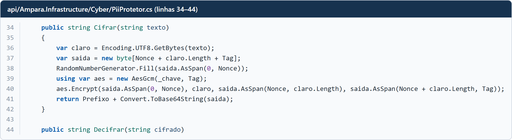

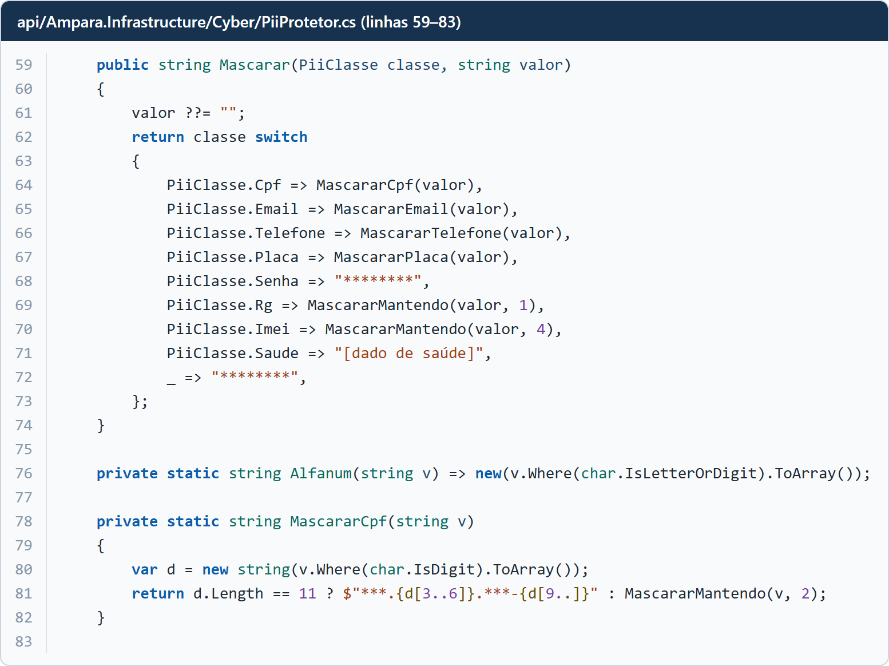

O banco da demonstração tem o IMEI do aparelho sintético só como texto cifrado (esse registro foi semeado antes do prefixo `enc:v1:`; o `PiiProtetor` ainda o lê, e toda gravação nova sai com o prefixo):

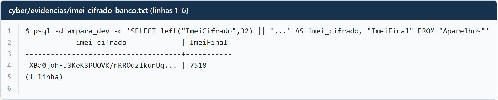

### 2.2 O código do parsing

`CpfDetector`: regex com validação dos dígitos verificadores, e lista de chaves que indicam a classe.

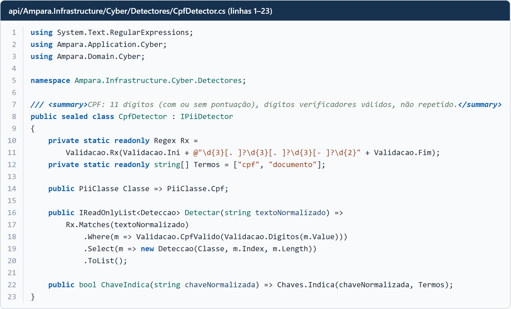

`PiiScanner`: percorre JSON em profundidade (objetos, arrays, números), pares chave/valor e texto livre. A classe achada pelo valor vence a da chave. Se um detector estoura o tempo da regex, o texto inteiro conta como a classe dele (falha fechada).

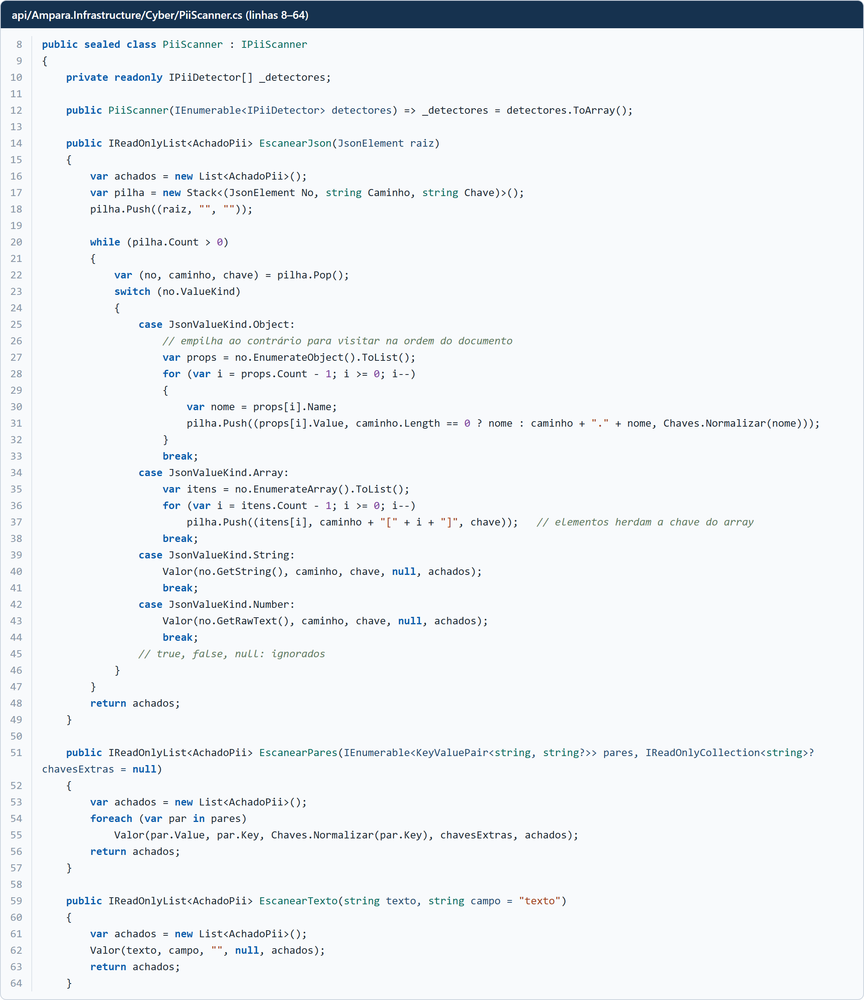

`PiiRequestMiddleware`: lê query, cabeçalhos e corpo (JSON, form, multipart), limita o tamanho (1 MiB) e a profundidade (64 níveis), e marca cada valor no escopo da requisição. Não bloqueia: a decisão é de cada sink. O corpo é rebobinado e o endpoint o lê normalmente.

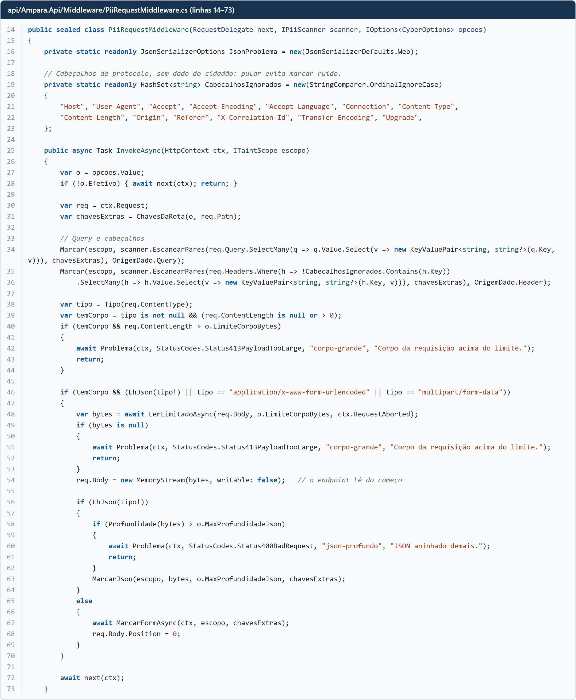

### 2.3 Precisão e recall

Corpus sintético de 387 linhas (220 positivas, 167 negativas), semente 42, gerado por `cyber/corpus/gerar_corpus.py`. Cada linha prevê a união das classes achadas pelos detectores no valor normalizado e pelas chaves do nome do campo.

| Classe | Positivos | TP | FP | FN | Precisão | Recall |
|---|---:|---:|---:|---:|---:|---:|
| Cpf | 49 | 49 | 0 | 0 | 100,0% | 100,0% |
| Rg | 22 | 22 | 0 | 0 | 100,0% | 100,0% |
| Imei | 25 | 25 | 0 | 0 | 100,0% | 100,0% |
| Telefone | 30 | 30 | 0 | 0 | 100,0% | 100,0% |
| Email | 24 | 24 | 0 | 0 | 100,0% | 100,0% |
| Placa | 23 | 23 | 0 | 0 | 100,0% | 100,0% |
| Senha | 26 | 26 | 0 | 0 | 100,0% | 100,0% |
| Saúde | 29 | 29 | 0 | 0 | 100,0% | 100,0% |
| **Global** | 228 | 228 | 0 | 0 | 100,0% | 100,0% |

Metas: precisão global ≥ 95%, recall global ≥ 90%, e por classe recall ≥ 85% e precisão ≥ 90%. **Cuidado ao ler os 100%:** o corpus foi escrito junto com os detectores, então os números medem regressão, não o desempenho em dado real (veja a seção 7).

<div class="quebra"></div>

## 3. Taint Analysis

**Ideia.** Um dado sensível é *marcado* quando entra (fonte), e *conferido* quando tenta sair (sink). Se o valor marcado, ou algo que pareça um dado pessoal, aparece num sink perigoso, o `TaintGuard` bloqueia, mascara ou cifra conforme `PoliticaTaint`, e deixa um evento no rastro. O bloqueio acontece **antes** da saída: o valor nunca chega ao log, à resposta pública, à polícia ou à IA.

### 3.1 Fonte → marcação → sinks

Fonte: `PiiRequestMiddleware` (HTTP) e `MqttPiiFilter` (chaveiro). Marcação: `ITaintScope`. Decisão: `TaintGuard.Sanitizar(texto, sink)`.

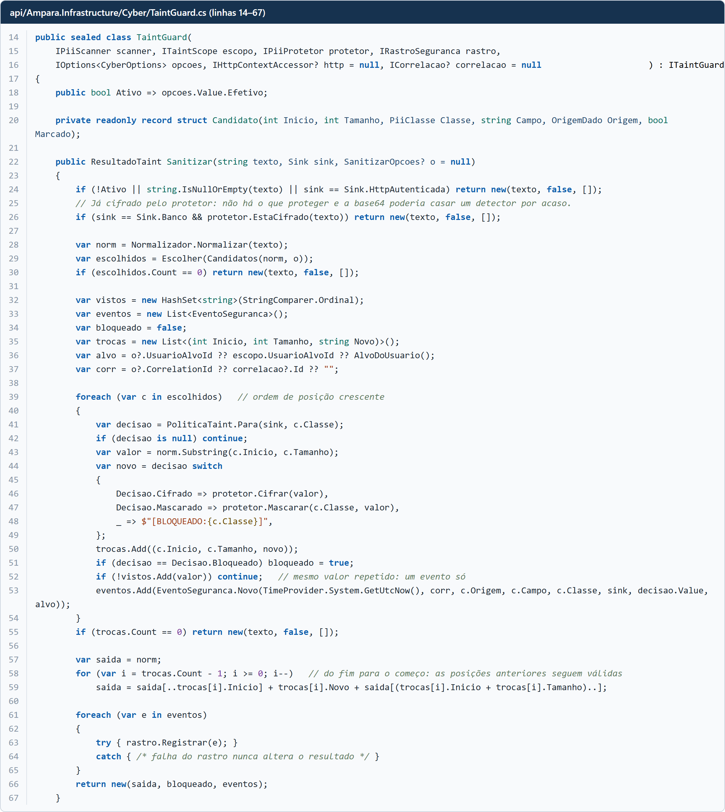

Política por sink (`PoliticaTaint`): Log, resposta pública, erro, Ponte, SignalR e IA **bloqueiam**; o banco **mascara** (e **cifra** o IMEI); a resposta autenticada ao dono só existe para registrar o caso permitido.

### 3.2 Um sink por linha

| Sink | Quem implementa | O que acontece com um dado sensível | Print |
|---|---|---|---|
| Log | `GuardedLogger` | A linha vira `[BLOQUEADO:Cpf]`; se a sanitização falha, a linha é suprimida | seção 3.2.1 |
| HttpNaoAutenticada | `RespostaNaoAutenticadaMiddleware` | A resposta é trocada por `problem+json` sem o dado | seção 3.2.2 |
| HttpAutenticada | `ImeiRevelador` | Só o dono vê o IMEI no BO; fica evento `Permitido` | seção 3.4 |
| Erro | `TaintExceptionHandler` | 500 com frase humana; stack e mensagem nunca saem | seção 4 |
| Ponte (polícia) | `TaintHttpHandler` | Pedido com PII é barrado antes de ir à rede | seção 3.2.3 |
| Llm (Claude) | `TaintHttpHandler` e `ClaudeTradutorRisco` | O prompt passa pelo guard; qualquer troca cancela o envio | seção 4 |
| SignalR | `TaintHubProtocol` | Frame sujo vira `TaintBloqueado`, sem argumentos | seção 3.2.3 |
| Banco | `TaintSaveChangesInterceptor` | `[TextoLivre]` é mascarado e `[PiiCifrado]` é cifrado ao salvar | seção 3.2.3 |
| MQTT (entrada do chaveiro) | `MqttPiiFilter` | O payload chega ao serviço com o campo livre mascarado | seção 3.2.3 |

#### 3.2.1 Log

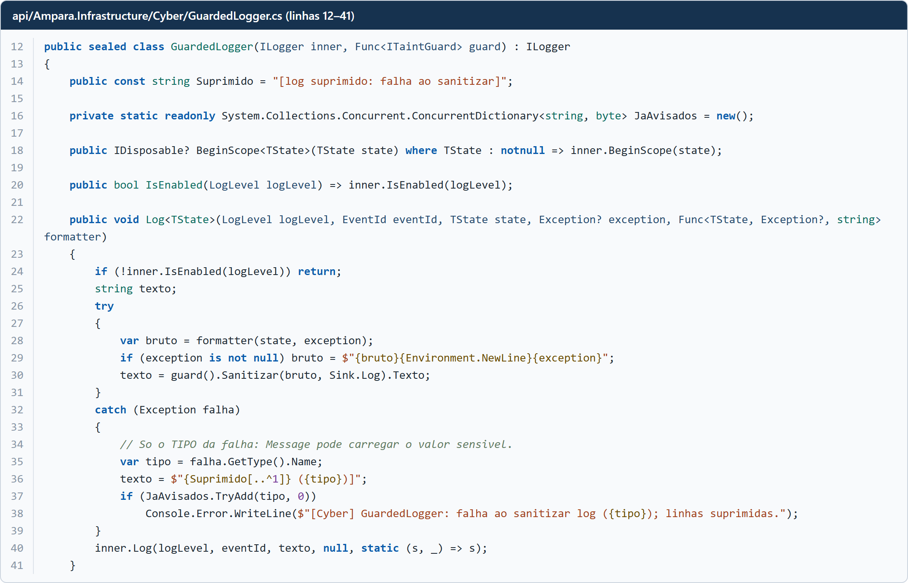

#### 3.2.2 Resposta pública

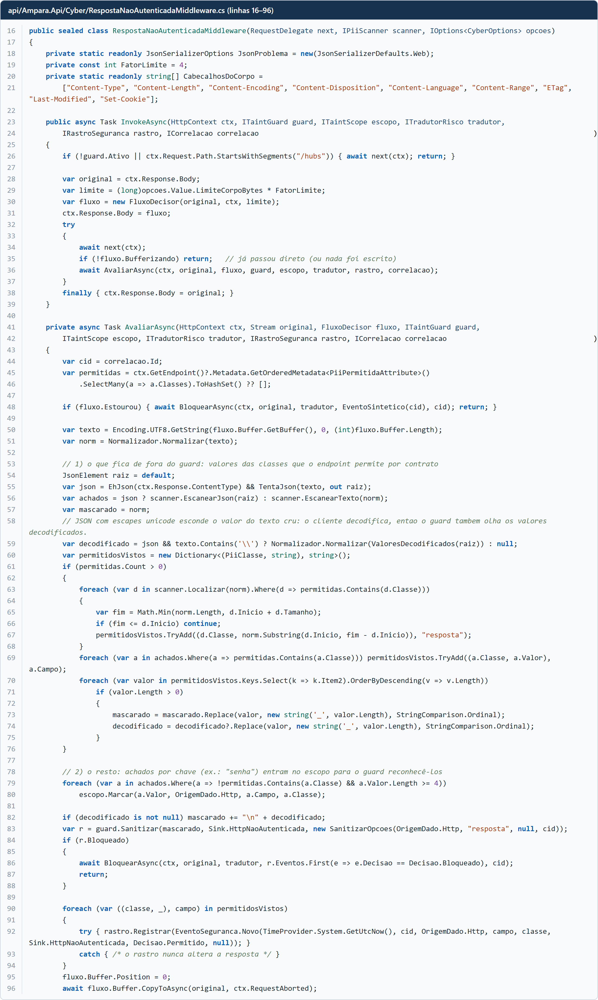

Resposta real do endpoint descuidado (da suíte de ataque, ataque A01) quando devolve o corpo recebido com um CPF. O status e o tipo são o da API real; o texto de `detalheCidadao` é o do tradutor falso da suíte (a chamada à IA é simulada nos testes):

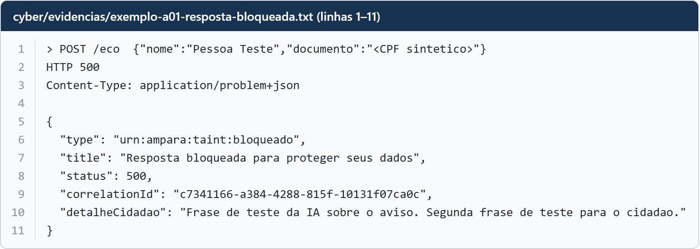

#### 3.2.3 Ponte, IA, SignalR, banco e MQTT

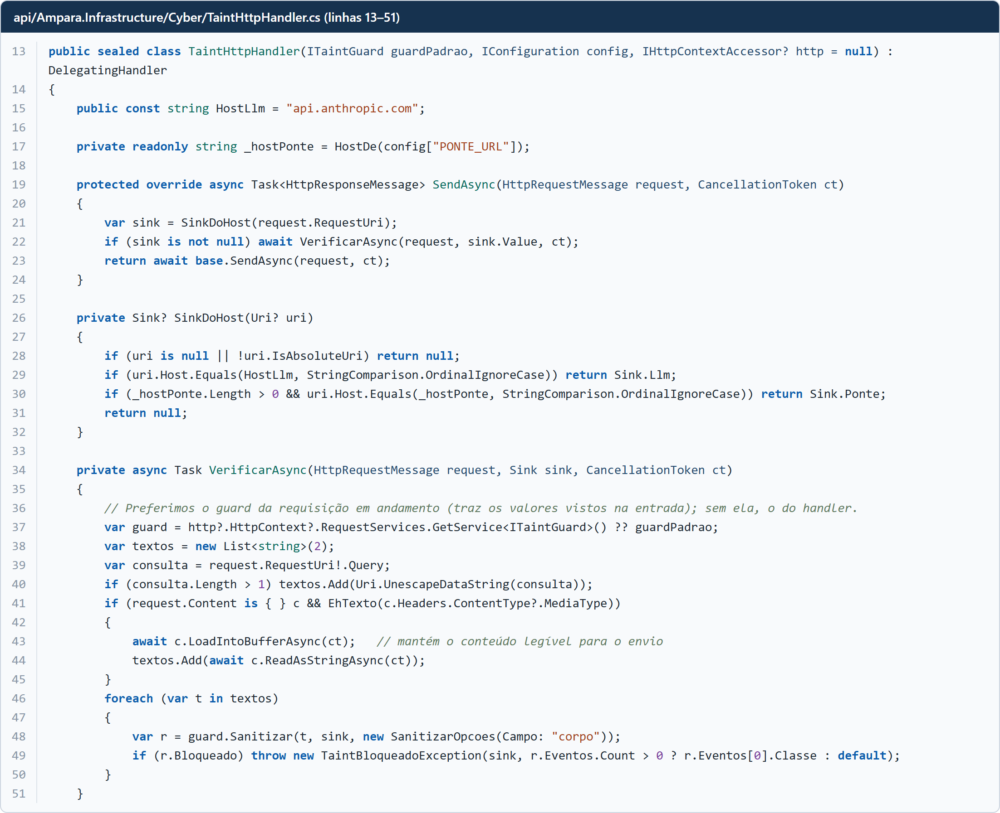

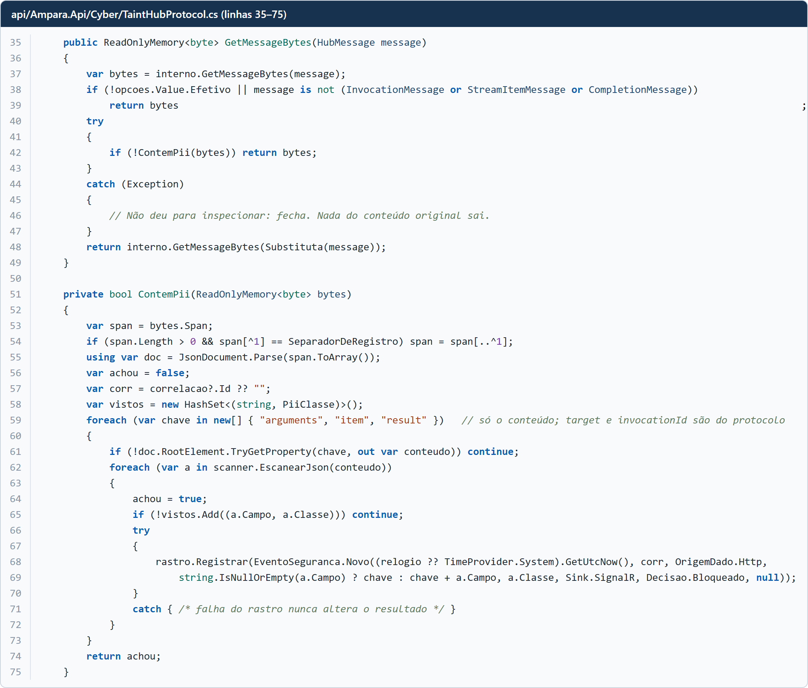

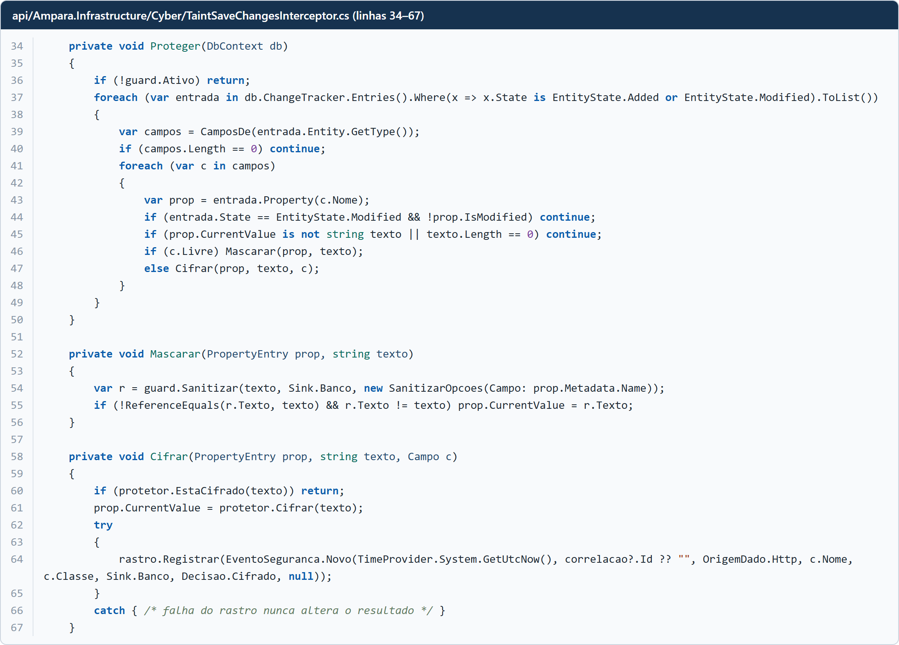

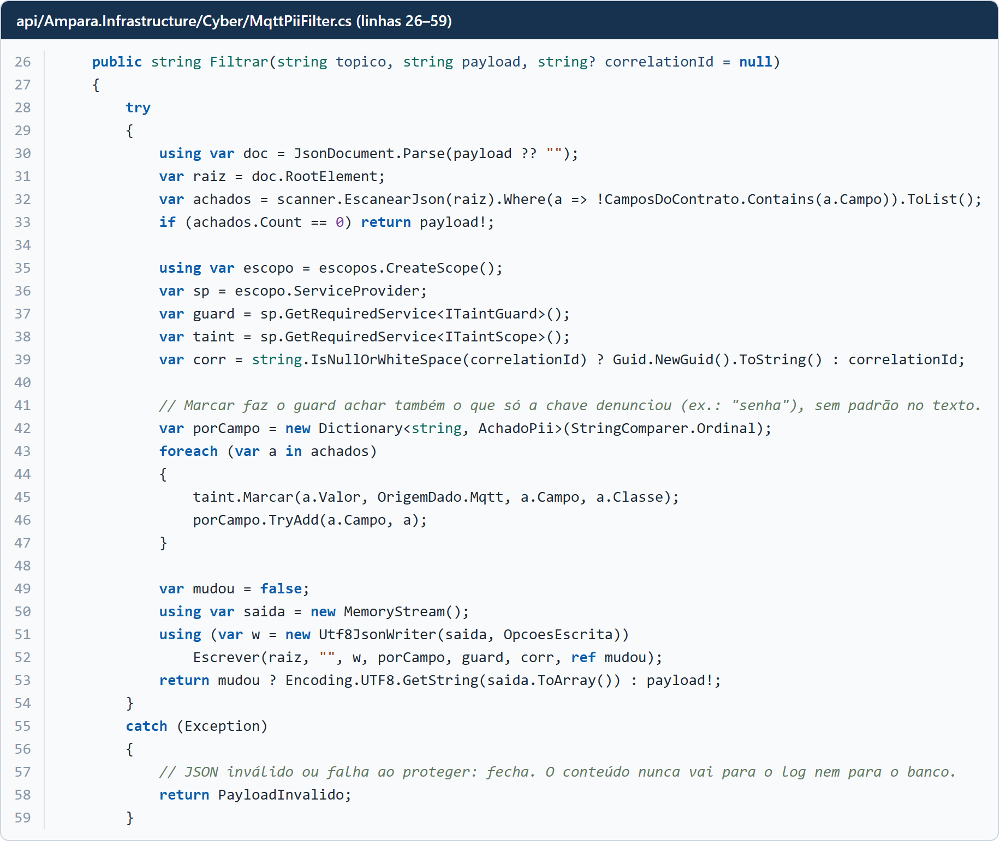

### 3.3 O rastro: consulta real, sem valor

Formato do evento: `{source, campo, classe, sink, decisão, correlationId}` (mais o usuário alvo e a hora). Abaixo, a consulta real ao banco depois dos cenários da demonstração (CPF no log, senha na resposta pública e acesso indevido). A tabela não tem coluna de valor, e a busca por pedaços do CPF e da senha usados no rastro inteiro devolve 0.

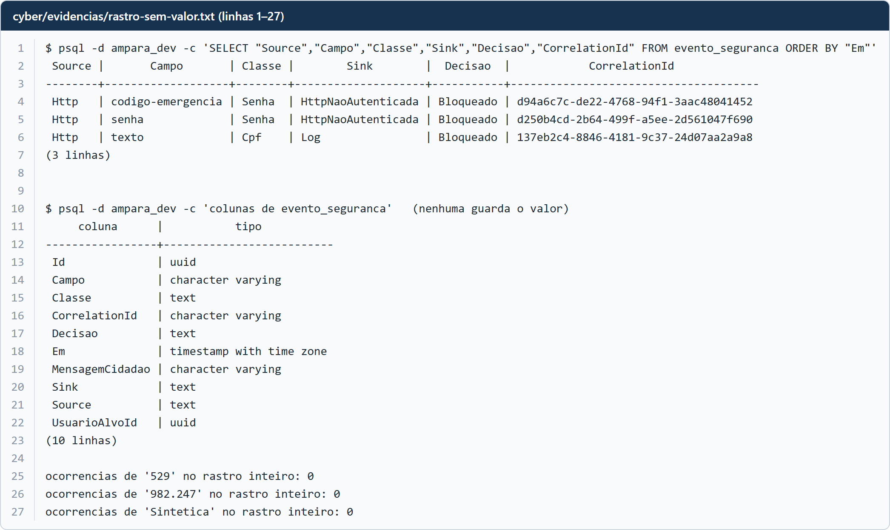

### 3.4 Antes e depois

Com o modo de demonstração (`AMPARA_DEMO=true`), a flag `Cyber__TaintAtivo=false` desliga o taint de propósito (sem `AMPARA_DEMO` ela é ignorada). O mesmo cenário (`cpf-no-log`, que registra "cadastro recebido com CPF …" com o mesmo CPF sintético) roda nas duas configurações:

| Antes (taint desligado) | Depois (taint ligado) |
|---|---|
| 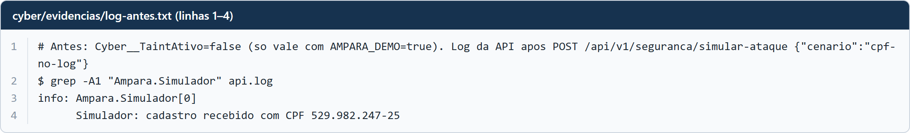 | 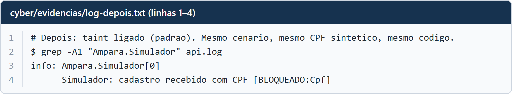 |

No ataque A11 da suíte a mesma flag faz a **resposta** vazar o CPF antes e bloquear depois.

### 3.5 Caso permitido: o IMEI só no BO do dono

O taint não é um "bloqueia tudo": o dono precisa ver o próprio IMEI para fazer o BO. O `ImeiRevelador` é o único ponto que decifra. Para o dono, devolve o IMEI e registra `Imei / HttpAutenticada / Permitido`. Para outro usuário logado, lança 403 e registra um **acesso indevido** contra o dono (peso 40 no índice). Para anônimo, 401 (ataque A07).

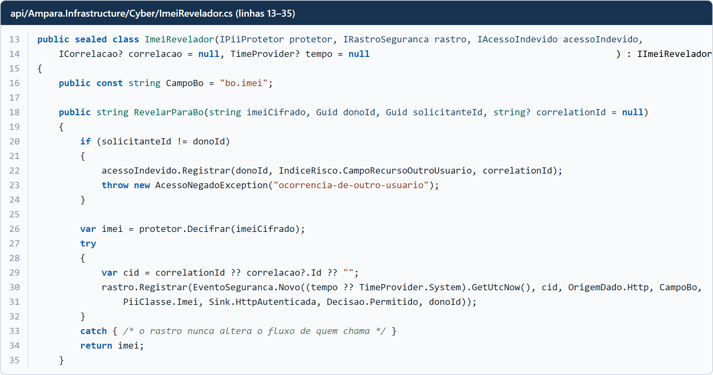

### 3.6 Suíte de ataque automatizada

13 ataques contra a API real (só banco, Claude e rede são falsos), regravados a cada `dotnet test cyber/Ampara.Cyber.Ataques`. Resultado da última execução: **13 aprovados, 0 falhas**.

| id | Vetor | Esperado | Resultado |
|---|---|---|---|
| A01 | CPF em JSON ecoado por endpoint anônimo | 500 problem+json, CPF ausente, evento HttpNaoAutenticada/Bloqueado | OK |
| A02 | CPF ofuscado (largura total, NBSP, caractere invisível, hífen suave, travessão, marca de direção, dígitos árabe-índicos, escape unicode) | todas as formas bloqueadas | OK: 10 formas, todas bloqueadas |
| A03 | CPF em cabeçalho, query e formulário num endpoint de depuração | nenhuma linha de log contém o CPF | OK: 3 linhas, CPF ausente |
| A04 | Exceção com laudo e CPF na mensagem | 500 com frase humana, sem "Error 500", sem stack | OK |
| A05 | Mensagem MQTT do chaveiro com CPF no campo livre | serviço recebe o CPF mascarado; `deviceId` e `eventId` intactos | OK: `***.982.***-25` |
| A06 | Senha ecoada em resposta pública (JSON e texto) | 500 problem+json, senha ausente | OK nas duas formas |
| A07 | IMEI no BO: dono, anônimo e outro usuário | só o dono vê; intruso leva 403 e vira acesso indevido (40) | OK |
| A08 | Prompt enviado ao Claude depois de eventos com CPF, senha, laudo | corpo só tem categoria, sink e tipo | OK: 7 prompts, nenhum com valor |
| A09 | Payload para a Ponte Polícia com e-mail do cidadão | barrado antes da rede; payload do contrato passa | OK |
| A10 | Frame SignalR com CPF (puro e em largura total) | vira `TaintBloqueado`, sem o CPF | OK |
| A11 | Flag `Cyber:TaintAtivo=false` (só com `AMPARA_DEMO`) | antes vaza, depois bloqueia; sem demo a flag é ignorada | OK |
| A12 | 50 POSTs simultâneos, CPFs distintos | 50 bloqueios, 50 `CorrelationId` distintos, sem mistura | OK |
| A13 | JSON com 200 níveis, corpo de 2 MiB, JSON inválido | 400, 413, 413, 400; nenhum 500 | OK |

<div class="quebra"></div>

## 4. IA na remediação

**Problema.** Um bloqueio de segurança que chega ao cidadão como "Error 500" não ajuda ninguém. A IA entra só para **traduzir** a falha em duas frases: o que aconteceu e o que a pessoa deve fazer. Ela nunca vê o dado.

### 4.1 O prompt exato

O `ClaudeTradutorRisco` monta este prompt com **somente categoria, sink e tipo** do evento (nunca o valor, o campo ou o texto original):

> Traduza a falha técnica '{Categoria} no {Sink}: {Tipo}' para um cidadão leigo de 60 anos, em 2 frases: a primeira diz o que aconteceu e a segunda diz o que a pessoa deve fazer. Não use termos técnicos e não repita nenhum dado pessoal.

A instrução de sistema dá ao modelo só o contexto fixo (o Ampara bloqueou, escondeu ou embaralhou o dado sozinho e nada foi exposto) e proíbe inventar telefones, centrais, links ou passos que o app não oferece. O pedido desliga o raciocínio estendido (`thinking`) do `claude-haiku-5-5`, que vem ligado por padrão e consumiria os 200 tokens antes da resposta; o cliente lê o primeiro bloco de texto da resposta.

Antes de enviar, o próprio prompt passa pelo `TaintGuard` (sink Llm): se qualquer parte dele for trocada ou bloqueada, nada sai e vale a frase padrão. A chamada HTTP ainda passa pelo `TaintHttpHandler` (segunda barreira). O ataque A08 captura os prompts reais e prova que nenhum tem valor.

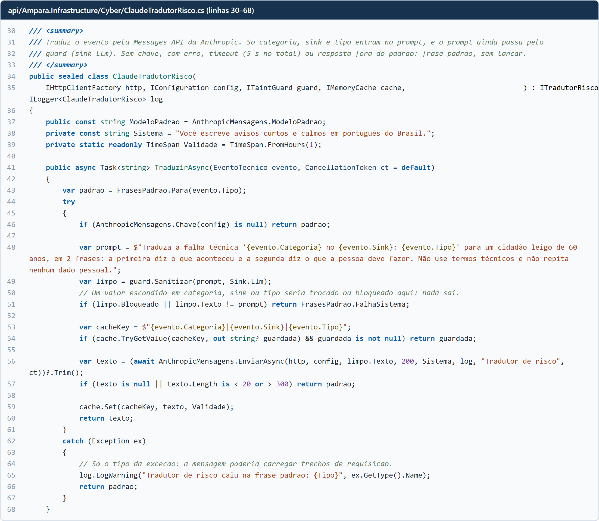

### 4.2 Mensagem padrão

Sem chave da API, com erro, com tempo esgotado (5 s no total) ou com resposta fora do padrão, o sistema devolve uma frase padrão fixa por tipo. A tradução nunca lança erro e nunca derruba a requisição. A frase de um bloqueio, por exemplo:

> Tentaram usar um dado seu em um lugar inseguro, e nosso sistema bloqueou a ação para proteger sua privacidade. Você não precisa fazer nada agora.

Os prints do painel deste documento foram feitos em 15/11 **com a chave da API definida** e o modelo `claude-haiku-5-5`: as frases dos cartões são as geradas pela IA (resultado em cache por 1 hora por combinação de categoria, sink e tipo). A frase padrão acima só aparece sem chave ou se a chamada falhar.

### 4.3 "Error 500" × frase humana

(Comparação ilustrativa: a coluna da esquerda mostra o que um servidor sem a camada devolveria; a da direita é o comportamento real, provado pelo ataque A04.)

| Sem a camada | Com a camada |
|---|---|
| `500 Internal Server Error` + `System.InvalidOperationException: falha ao gravar laudo F32 do CPF 529.982.247-25 … at Ampara…` | `500` com `application/problem+json` e a mensagem: "Algo deu errado do nosso lado e a ação não foi concluída. Tente de novo em alguns minutos; seus dados continuam protegidos." |
| O cidadão vê um erro técnico e o CPF e o laudo vazam no corpo e no log | O cidadão lê duas frases simples; o corpo não tem stack, tipo de exceção nem dado; o log recebe a exceção mascarada |

### 4.4 Resposta `problem+json`

Resposta real da API ao ataque A04 (exceção inesperada com laudo e CPF na mensagem). O corpo tem só `type`, `title`, `status`, `correlationId` e `detalheCidadao`. Nos testes a IA é simulada, por isso a frase do print é a do tradutor falso da suíte:

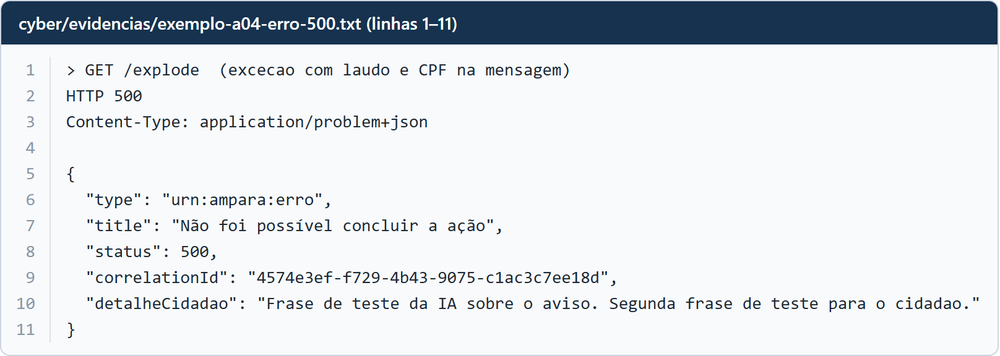

`TaintExceptionHandler` é quem monta essa resposta: a exceção completa passa pelo guard (cada classe achada vira evento `Erro / Bloqueado`), e o log recebe a exceção já mascarada.

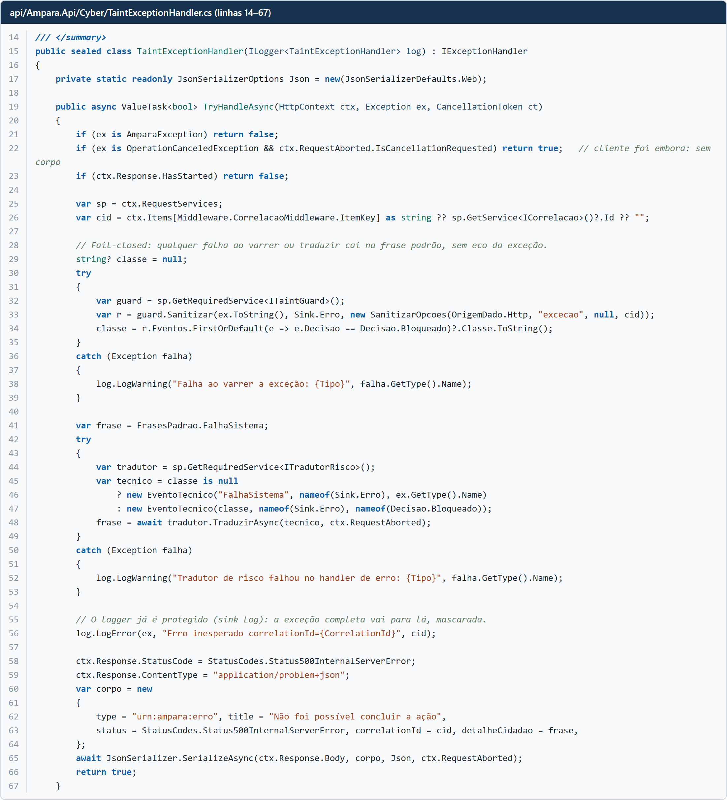

### 4.5 Moderação dos relatos (bônus)

Os relatos de risco do mapa têm texto livre. O `ClaudeModeradorRelato` primeiro **remove toda PII** (cada trecho achado vira `[dado removido]`), depois pede à Claude a classificação `ABUSIVO` ou `OK`. Sem chave, com erro ou com resposta fora do padrão, o relato é aceito **sem texto** (fallback), nunca com o texto cru.

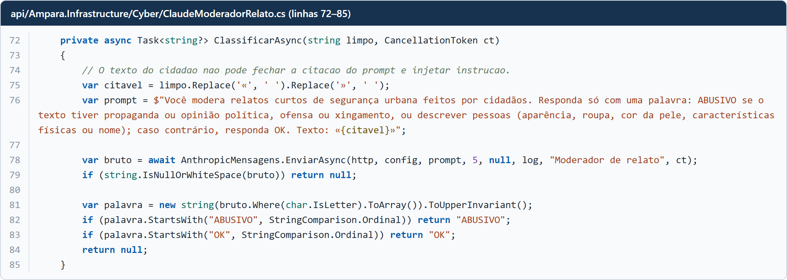

<div class="quebra"></div>

## 5. Painel Risco Cidadão

Painel web (React) em `web-painel-risco/`, porta 5174. O cidadão entra e vê o **índice de risco** das últimas 24 horas, o **farol** e a mensagem humana de cada evento. O administrador tem ainda a **visão executiva**.

### 5.1 Pesos e limites do farol

Só eventos com decisão `Bloqueado` somam. Janela de 24 horas, soma limitada a 100.

| Evento bloqueado | Peso |
|---|---:|
| Acesso indevido (código de emergência errado ou recurso de outro usuário) | 40 |
| Dado sensível em resposta pública (`HttpNaoAutenticada`) | 25 |
| Qualquer outro bloqueio (log, erro, Ponte, SignalR, IA, banco) | 10 |
| Mascarado, cifrado ou permitido | 0 |

| Índice | Farol |
|---|---|
| 0 a 29 | Verde: "Seguro" |
| 30 a 69 | Amarelo: "Atenção" |
| 70 a 100 | Vermelho: "Risco alto" |

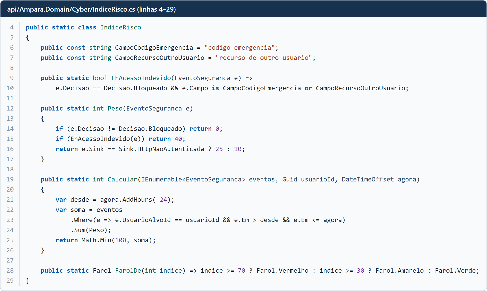

### 5.2 Verde → amarelo → vermelho

O simulador da demonstração (seção 5.4) aciona três cenários, na ordem: **Acesso indevido** (40), **Senha na resposta pública** (40 + 25 = 65) e **Vazar CPF no log** (65 + 10 = 75).

| Verde: índice 0 | Amarelo: índice 40 |
|---|---|
| 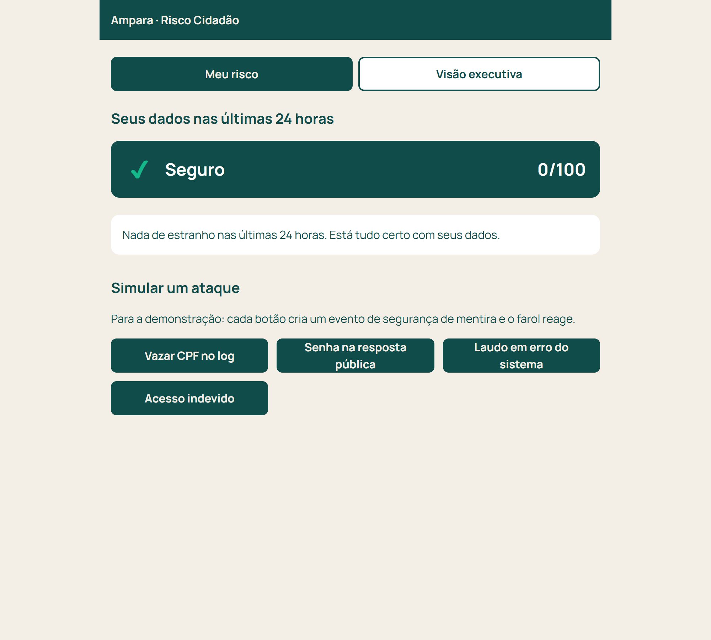 | 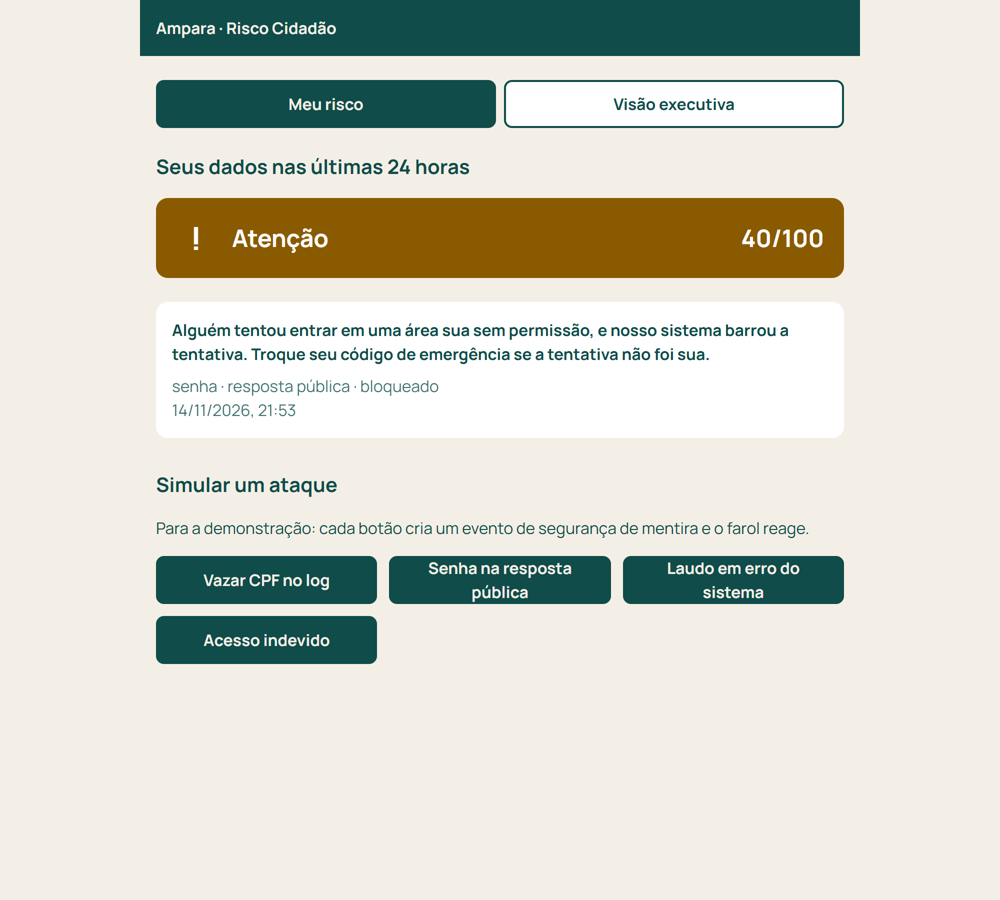 |

| Amarelo: índice 65 | Vermelho: índice 75 |
|---|---|
| 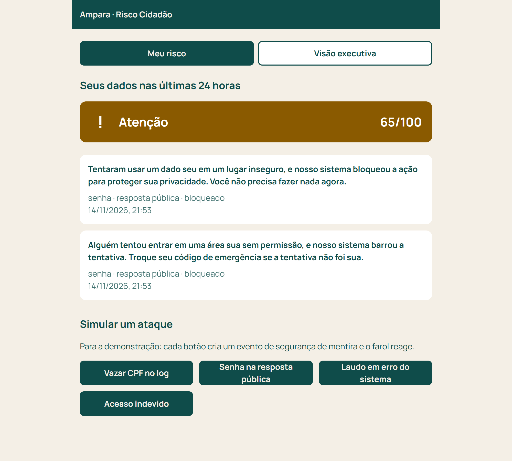 | 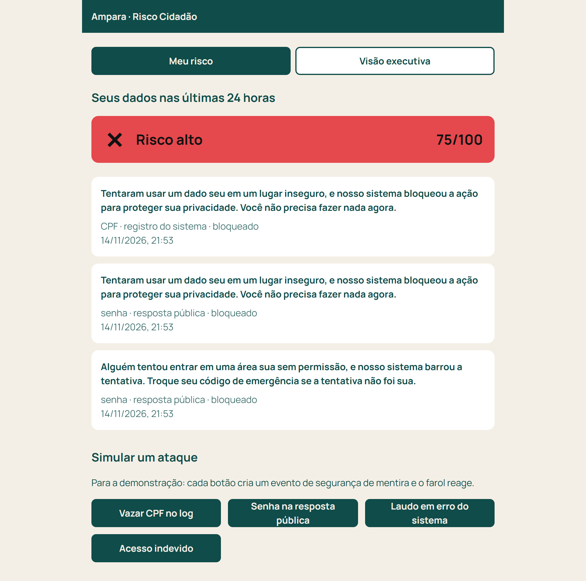 |

O painel não usa só a cor: cada farol tem palavra (Seguro, Atenção, Risco alto) e ícone, e os contrastes de cor são cobertos por teste (`contraste.test.ts`). As frases dos cartões foram escritas pela IA (`claude-haiku-5-5`) a partir só da categoria, do sink e do tipo do evento.

### 5.3 Visão executiva (administrador)

Totais das últimas 24 horas por tipo de dado e por ponto de saída, e eventos por hora. Pelo contrato, o acesso indevido é gravado como classe `Senha` no ponto de saída `HttpNaoAutenticada` (o contrato não cria uma classe só para ele; o campo `codigo-emergencia` ou `recurso-de-outro-usuario` é que o distingue); por isso, depois de um acesso indevido e de uma senha ecoada, as barras mostram "senha 2" e "resposta pública 2". É a visão de quem acompanha a plataforma inteira; só o papel `admin` a vê (as outras contas recebem 403 e uma mensagem). O usuário `admin` só existe no modo de demonstração.

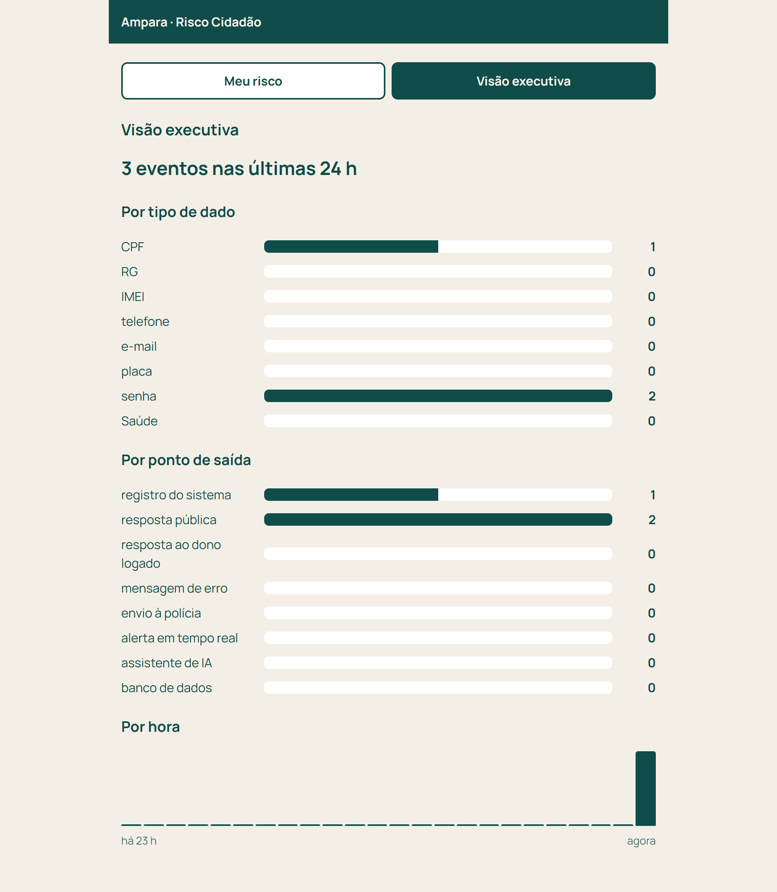

### 5.4 Como o simulador gera atividade

Com `AMPARA_DEMO=true`, a rota `POST /api/v1/seguranca/simular-ataque` executa o **fluxo real** (logger protegido, guard, registro de acesso indevido) com valores sintéticos fixos, em nome do usuário logado. Não há evento "de mentira" gravado à mão: o log realmente tenta escrever o CPF e o `GuardedLogger` o bloqueia. Fora do modo de demonstração a rota responde 404. Cenários: `cpf-no-log`, `senha-na-resposta`, `laudo-no-erro`, `acesso-indevido`.

<div class="quebra"></div>

## 6. Como executar e testar

Pré-requisitos: SDK .NET 11 (`api/global.json`), PostgreSQL, Node 20+ e o Edge ou Chrome já instalados (para prints e PDF). Segredos só em variável de ambiente (`.env.example` lista todas, sem valores).

```bash
# no Git Bash (Windows): o SDK 11 do scoop vem antes do dotnet do sistema
export PATH="$HOME/scoop/apps/dotnet-sdk/current:$PATH" DOTNET_ROOT="$HOME/scoop/apps/dotnet-sdk/current"

# 1) testes da API (motor de PII, taint, painel): 480 testes, sem banco nem rede
dotnet test api/Ampara.sln

# 2) suíte de ataque (13 ataques + 1 teste do exemplo versionado; regrava cyber/evidencias/ataques.md)
dotnet test cyber/Ampara.Cyber.Ataques

# 3) painel: testes e build
cd web-painel-risco && npx vitest --run && npm run build && cd ..

# 4) subir tudo para a demonstração (AMPARA_DEMO=true semeia admin@ampara.demo e vitima@ampara.demo)
#    a API não lê o .env sozinha: copiar o exemplo, preencher e exportar antes do dotnet run
cp .env.example .env                                        # preencher AMPARA_DB, AMPARA_JWT_SECRET, AMPARA_CRYPTO_KEY
set -a; . ./.env; set +a
dotnet run --project api/Ampara.Api -- --migrar
AMPARA_DEMO=true dotnet run --project api/Ampara.Api        # porta 5080
cd web-painel-risco && npm run dev                          # porta 5174

# 5) evidências e entregas
bash cyber/scripts/zerar-demo.sh                            # índice volta a 0
node cyber/scripts/prints-painel.mjs                        # prints do painel
bash cyber/scripts/evidencias.sh                            # confere se nada falta
(cd cyber/scripts && npm ci && node gerar-pdf.mjs)          # PDF
bash cyber/scripts/gerar-zip.sh                             # ZIP do código
```

Resultado da última execução completa (15/11): `api/Ampara.Tests` com 480 aprovados e 0 falhas; `cyber/Ampara.Cyber.Ataques` com 14 aprovados (13 ataques + 1 teste do exemplo versionado) e 0 falhas; painel com 36 testes.

<div class="quebra"></div>

## 7. Limitações honestas

- **Corpus sintético.** O corpus de precisão e recall foi escrito junto com os detectores: os 100% medem regressão, não o desempenho em dado real. Em produção haveria falsos positivos e negativos que o corpus não mostra.
- **Regra por chave é ampla.** Um campo chamado `cidade` indicaria Saúde (casa o prefixo `cid`). Por valor, 10 dígitos soltos não são telefone (confundem com data Unix), e 11 dígitos soltos com terceiro dígito 9 e dígito verificador de CPF inválido contam como telefone.
- **Peso 10 para quase tudo.** Todo bloqueio que não seja resposta pública (25) nem acesso indevido (40) vale o mesmo peso (10), seja log, erro, Ponte, SignalR, IA ou banco. É uma simplificação: um vazamento para a polícia pesa o mesmo que uma linha de log.
- **Broker MQTT público.** O chaveiro conversa com a API por um broker MQTT público (`broker.hivemq.com`); o payload tem o filtro de PII, mas o canal em si não é privado nem autenticado. Para produção seria preciso um broker próprio com TLS e credencial por dispositivo.
- **Frases da IA variam.** Os prints de 15/11 mostram frases reais da IA; outra execução pode gerar frases diferentes (sempre 2 frases, sem dado pessoal, validadas por tamanho). Os testes automatizados usam resposta simulada.
- **Escopo do taint.** O guard reconhece o valor marcado na entrada e o que o scanner reconhece por padrão. Um dado sensível que mude de forma no meio do caminho (por exemplo, cifrado por código novo e depois escrito em log) não é reconhecido.
- **Demonstração.** O simulador, o usuário `admin` e a flag que desliga o taint só existem com `AMPARA_DEMO=true`; em produção esse valor deve ser `false`.
