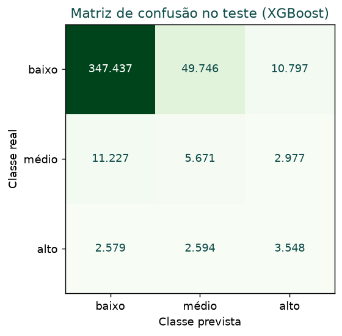
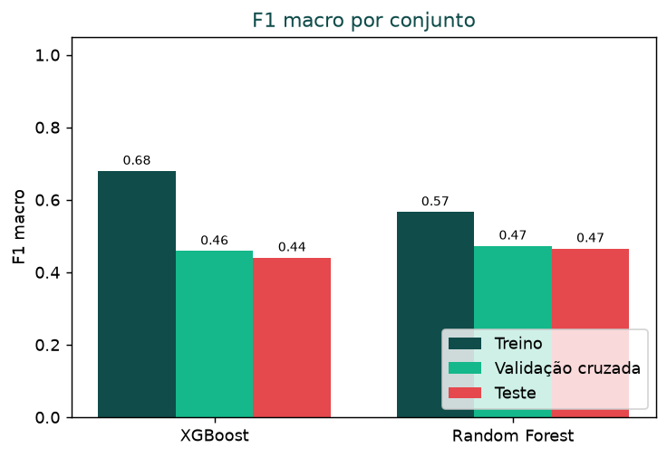
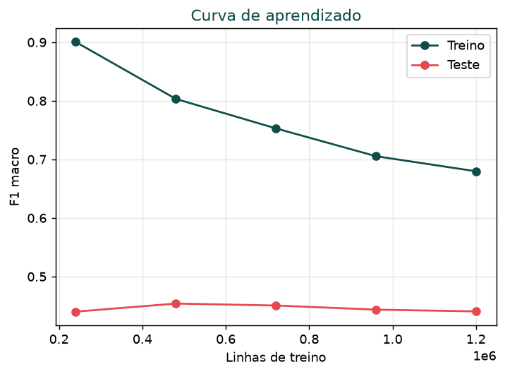

# Ampara ML: risco de roubo e furto em via pública (proxy de celular) por área e horário em São Paulo

Global Solution 2026.2 FIAP, CitizenTech. Pedro Martins (RM_____) e Vitor Cesarino Marchese (RM_____). Vídeo: (preencher ao publicar).

## 1. Problema e dados

**Pergunta:** dada uma área de cerca de 500 m × 500 m da capital, um dia da semana e uma faixa de 3 horas, qual a classe de risco (baixo, médio, alto) no próximo trimestre? Fontes reais e públicas: SSP-SP (boletins de ocorrência, 2022 a 2025), GeoSampa (estações, delegacias, iluminação, distritos), Open-Meteo (temperatura e chuva horárias) e IBGE (Censo 2022, população por distrito). Links e datas de acesso: `dados/README.md`.

**Limpeza.** A SSP não tem coluna de celular, então o alvo é um *proxy*: roubo ou furto em via pública na capital. Foram lidas 4.792.984 linhas; 828.618 passaram na limpeza (data, hora e coordenada dentro da grade) e 825.021 estão na janela 2022–2025. Entram no modelo as 1.949 células com pelo menos 120 ocorrências no treino. Linhas com hora ausente (cerca de 32 % da base do proxy) ficam fora do modelo, pois não cabem numa faixa horária. A grade de 500 m vale porque 93,0 % das linhas válidas têm coordenada. O clima usa um único ponto para a cidade.

## 2. Modelo escolhido

**XGBoost** como modelo principal: os dados são tabulares, as relações são não lineares (hora × dia × local), as classes são desbalanceadas e o modelo dá importância de variáveis. **Random Forest** como baseline, para mostrar se o ganho vem mesmo do boosting. MLP e LSTM foram descartadas: são só 16 trimestres e uma tabela de poucas colunas.

## 3. Preparação e divisão

O alvo é a contagem de ocorrências por área, trimestre, dia e faixa. Três classes, com cortes calculados **só no treino**: baixo até 1, médio 2, alto acima de 2 (a classe alto é cerca de 2 % do treino). As variáveis são estruturais (posição, dia, faixa, distâncias, clima, densidade, iluminação) e defasadas (trimestres anteriores da própria área). A divisão é temporal, sem embaralhar: treino de 2022T2 a 2024T4 (1.200.584 linhas), teste em 2025 (436.576 linhas). A validação cruzada é temporal, com 3 janelas expansivas. Sem vazamento, e os testes automáticos provam: os cortes só vêm do treino, as variáveis defasadas não enxergam o próprio alvo nem o futuro, e a validação nunca treina em período posterior ao validado. As variáveis externas não são defasadas: o clima é o do próprio trimestre no treino e o do ano anterior na previsão, e o cadastro do GeoSampa é o de 2026.

## 4. Treino e hiperparâmetros

Métrica: F1 macro (escala de 0 a 1, com ponto decimal), que não deixa a classe baixo esconder erros na classe alto. Foram sorteadas 12 combinações do XGBoost e 4 do Random Forest, todas no notebook. As 5 melhores do XGBoost:

| n_estimators | max_depth | learning_rate | F1 macro (CV) |
|---|---|---|---|
| 400 | 9 | 0.30 | 0.459 |
| 200 | 9 | 0.30 | 0.440 |
| 100 | 9 | 0.10 | 0.421 |
| 200 | 7 | 0.30 | 0.417 |
| 100 | 9 | 0.03 | 0.417 |

Melhor Random Forest: 100 árvores, profundidade 16, mínimo de 5 amostras por folha, F1 macro de CV 0.473.

## 5. Resultados

| Modelo | F1 treino | F1 CV | F1 teste | Treino − teste |
|---|---|---|---|---|
| XGBoost | 0.680 | 0.459 | 0.440 | 0.239 |
| Random Forest | 0.566 | 0.473 | 0.466 | 0.101 |

<table><tr>
<td width="33%">

</td>
<td width="33%">

</td>
<td width="33%">

</td>
</tr></table>

**O baseline ganhou.** O Random Forest foi melhor na validação e no teste e sobreajustou menos. O XGBoost decora o treino (F1 de 0.680 contra 0.440 no teste) e a curva mostra isso: com mais dados o F1 de treino cai e o de teste fica parado perto de 0.44. A acurácia (0.817 e 0.831) engana: 93 % das linhas são da classe baixo. O `risco.csv` usa o XGBoost por decisão do projeto, não por ter vencido.

## 6. Conclusão e leitura para o cidadão

O modelo mostra **onde e quando** o risco histórico é maior. No `risco.csv` de 2026T1, as combinações de maior risco ficam na região central, sobretudo das 18h às 21h; mais da metade das combinações de classe alto cai entre 18h e meia-noite, e sexta é o dia de risco médio mais alto. O app usa `prob_alto` para ordenar áreas e horários e pintar o mapa; ela não é calibrada e nunca deve ser lida como chance de ser vítima.

**Limites:** o modelo indica áreas e horários, não pessoas, e não prevê crime individual. Boletim subnotifica, e há mais registro onde há mais policiamento. O último trimestre (2025T4) está subcontado, cerca de 7 % abaixo dos outros de 2025, porque fatos do fim do ano registrados em 2026 não estão nas planilhas; isso puxa um pouco para baixo o teste e o risco exportado. **Próximos passos:** treinar o modelo final também com 2025, calibrar as probabilidades e testar o Random Forest como modelo exportado.
